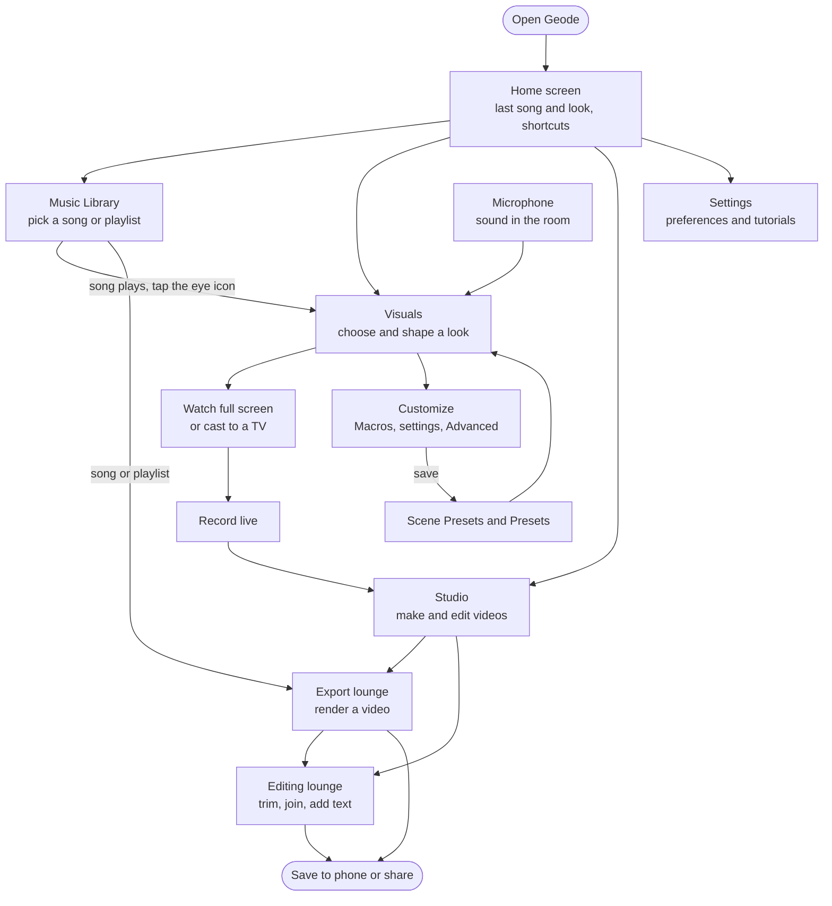

# Geode

> This is an overview of the app, to help with understanding Geode as a whole. It is context only: it is not used to make decisions.

## Music you can see

Geode is a music player for Android that turns every song into a living picture. Press play and the music takes shape on your screen as a moving visual that pulses, flows and changes with the sound. You choose the look, shape it until it feels like yours, and when you want to keep a moment, you record it or render the whole song into a video ready to share.

People come to Geode for the visuals, but it is a complete music player too. It finds the music on your phone, plays it well, and is just as happy running quietly in your pocket when you don't feel like watching. Geode is for anyone who loves music and visuals. It is easy to pick up in a minute, and there is plenty of depth for those who want to dig in. It works fully offline, with no account and no sign-in. You only need the internet when you share a video.

## How Geode fits together

The home screen is where every visit starts. It greets you with the last song you played and the last visual you watched, ready to pick up where you left off, and it points the way to everything the app can do. You can choose what it shows, such as shortcuts, your favourite Presets or your recent plays. From here you move into one of four places: the **Music Library**, where your music lives; **Visuals**, where the music comes to life; **Studio**, where music and visuals become video; and **Settings**, where you make the app work your way.

## Your music

The Music Library is a full music player in its own right. Your tracks, artists, albums and playlists are all there to browse and search. You can build your own playlists, let smart playlists fill themselves by rules you set, import and export playlists, line up a queue, mark favourites and look back at what you've listened to. Songs can flow into each other without gaps or with a crossfade. A sleep timer fades the music out as you drift off, an A-B loop repeats the part of a song you love, and Geode remembers where you stopped. An equalizer, crossfeed for headphones and volume levelling keep everything sounding right.

While music plays, a mini player stays with you at the top or bottom of the screen. The music keeps going in the background, with controls on the lock screen and in the notification, and a home-screen widget shows what is playing. You can even set the visual as your phone's live wallpaper.

The library is also the doorway to everything else. A small eye icon at the top of the screen takes you straight to the visual for the song that is playing, and any song or playlist can be sent to Studio to become a video.

## Your visuals

This is the heart of Geode. Visuals react to whatever you are listening to, either a song from your library or the sound around you through the microphone. Point your phone at a speaker, a band or a DJ and the visual moves with the room just as it does with your own music. That makes Geode as much at home at a party or a live show as it is on the sofa, and a natural tool for making clips for social media.

Every look in Geode belongs to a **Style Family**, a group of visuals that share the same way of moving and reacting to music. Within each Family are **Styles**, variations with their own look and extra touches. New Families are added regularly. Geode also includes MilkDrop, the classic music visualizer with a huge world of community-made presets. A set of MilkDrop presets comes built in, and you can import your own packs and textures.

Finding a look is simple. Browse the Families with live previews, pick one, choose a Style, and the visual starts moving to your music. If you have a favourite look saved, one tap brings it back exactly as you left it. Switching between looks happens with a smooth transition, so the music never feels interrupted.

Once a visual is playing, you can let it fill the whole screen, or drag the panels down to see all of it. The panels can be made see-through, so every change you make shows on the visual straight away. A long press in full screen brings up a side bar with the Macros and a record button. You can also send the visual to a bigger screen, such as a TV. When you leave Visuals the picture pauses but the music plays on, and the same look is waiting when you come back.

## Making it yours

Customization lets you change how a visual looks and behaves: its speed, its motion, its colours, how strongly it reacts to the music and how it responds when you touch it. It is built in three layers, so everyone finds their own level. Six big **Macros** give you instant, satisfying control with a single turn. The **Customization** settings offer clear, friendly controls that anyone can understand. **Advanced** opens a full modulation matrix for those who want to go deep, with a patch board for wiring parts of the sound to any setting and modulators that move settings on their own over time. A randomize button throws up surprise looks, and you can save colour palettes to reuse. A setting means the same thing in every Family, while each Family keeps its own character in how it answers the music.

When you have something you love, you can keep it. A **Scene Preset** saves the whole look in one go: the Family, the Style and every setting. A **Preset** saves just the settings, so you can try them on other Styles. Both can be sorted into folders. Even if you never save, Geode remembers your current look for next time.

Moving the visual by tilting the phone, so that gravity pulls it around, is a planned feature that is not built yet.

## Recording and video

When something beautiful happens on screen, hit record. Geode captures the visual and the sound together, never the app's own screens, and keeps recording even if you move around the app. You can keep playing with the Macros and touching the visual while you record, and every change ends up in the video. If you want more control later, Geode can also save each change you made as separate lanes next to the video, ready to be edited in Studio.

Studio is where music and visuals become finished video. In the **export lounge** you choose a song or a whole playlist, pick a look, and choose a vertical, square or wide format and the quality you want. Geode then renders the video from the music itself, which means it can look ahead in the song and react even more precisely than the live visual. You can make a short clip that loops seamlessly, long playlist videos get a chapter for each song, and the sound is levelled to a good loudness for sharing. Rendering happens in the background while you keep listening, and a notification tells you when the video is ready. For the fastest route, Quick Export renders the song that is playing with the current look in one tap, and any song or playlist in the library can be exported directly.

In the **editing lounge** you shape your videos, whether Geode made them, you recorded them or you already had them on your phone. A timeline with keyframes, curves, markers and undo lets you trim and cut. Clips can be cut automatically on the beat, joined with transitions, sped up or slowed down with speed ramps, and finished with filters and colour grading. You can add text such as the song title, the artist, captions or lyrics, timed to the music. If a recording was saved with its lanes, you can edit those changes, add new ones and render a clean new video from the song. Your work is kept as a project you can return to, and when you're done you save the video to your phone or share it.

## Settings, safety and help

Settings gathers all your preferences in tabs sorted by topic: what the home screen shows, how gestures and panels behave in Visuals, recording options, where the mini player sits, default folders and playback, export defaults, language, and importing your library and data from an older version of Geode. Tutorials and help are always there, and if something goes wrong you can send a problem report with personal data removed.

Geode takes care of the people watching. Because visuals can flash, Geode warns you and asks for your consent before the first one plays, and a flash limiter and a no-flash mode protect anyone sensitive to flashing light. Reduced motion calms the app's own animations, and text is kept readable for everyone.

## A day with Geode

The first time you open Geode, it asks to read your music and scans your library. A short tour shows you the Library, the Visuals, what the Macros do and what Studio can make, and lets you switch features on or off before you land on the home screen.

You tap a song in the library and it starts to play. You tap the eye icon, and because you haven't picked a look yet, the chooser opens. You pick a Family and a Style, and the visual comes alive with the music. You open Customization, make it bluer and wilder with the panels see-through so you can watch it change, and save it as a Scene Preset. In full screen you long-press, turn the Macros, touch the visual and hit record. Later, in Studio, you render the whole song as a vertical video, keep listening while it renders, trim it, add the song title and share it.

The next day, the home screen shows yesterday's song and look, ready to resume. That evening at a party, you switch the visual to the microphone, go full screen and cast it to the TV, and the whole room can see the music.
