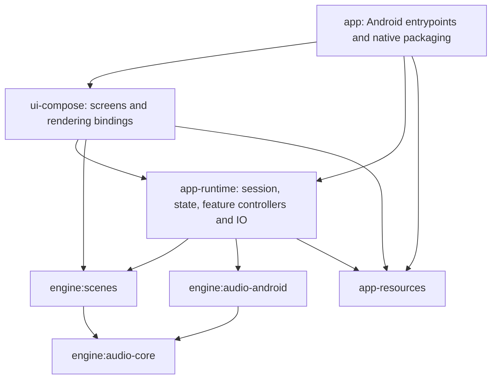

# Geode architecture

## Implemented structure

The build now enforces the presentation dependency direction:

- `app` owns MainActivity, GeodeApp, the Glance widget renderer, the manifest,
  assets, launcher splash theme, native packaging and release configuration.
- `ui-compose` owns Compose screens, controls, navigation, theme drawing,
  Studio preview and GL view bindings. Its public entrypoint is `AppRoot()`.
- `app-runtime` owns the session, ViewModel state/action adapters, controllers,
  playback, persistence, export, capture and wallpaper integrations. Feature
  controllers retain internal visibility. It cannot import the Compose screen
  module or the application launcher. Existing Kotlin package names are retained
  for this migration; `dev.geode.ui` under runtime contains no Composables.
- `app-resources` owns shared Android resources. This avoids duplicating strings,
  themes and assets or making runtime depend on the application.
- Existing engine modules and the C++ core retain their responsibilities.

To replace the main UI, implement a new presentation module consuming the runtime
ViewModels and StateFlows, replace the `ui-compose` dependency in `app`, and change
MainActivity's content entrypoint. Preserve its Android intent/permission handling
or supply an equivalent launcher. Runtime, playback and export require no screen
changes. A non-Compose presentation can use the same application state/actions;
this is a build-time replacement, not a downloadable skin/plugin system.

Theme preference persistence was separated from theme drawing. Navigation mapping
and export labels live in presentation. ThemePack still uses Compose graphics
Color, and ViewModels use Android lifecycle: runtime is not a pure Kotlin domain
module yet. Shared resources also contain the original skin's assets. Removing
those residual representation dependencies is separate from swapping screens.

The application implements `GeodeContainerOwner`; runtime accesses the container
through that contract. Widget state publishing invokes an application-supplied
suspend redraw callback, keeping Glance out of runtime. Service notifications
resolve the application's launcher through PackageManager. The About screen
reads installed-package version metadata, avoiding an application BuildConfig
reference from the presentation library.

CI now runs tests and static analysis across modules. Theme import and style
collection tooling follow the new source/resource ownership. Existing detekt
baseline entries move with their files; new violations are not baselined away.

## Live feature delivery

The GL renderer can read a feature provider once at frame submission. The
foreground UI binds it to the latest analysis snapshot and enriches progress
and section metadata using StateFlow snapshots. High-frequency feature delivery
no longer waits for a Compose coroutine collector to forward each frame.

The provider must be non-blocking, safe on the GL thread and treat published
feature arrays as immutable. It must never access a main-thread-only player.
Disposal clears the provider and the PCM/error callbacks so a retained view does
not keep its old ViewModel through those bindings.

The existing direct feature property remains the fallback for wallpaper
rendering. Offscreen export retains its independent rendering path. This is a
bounded scheduling refactor, not the proposed fully native analysis pipeline:
PCM buffering, FFT scheduling and UI-derived progress metadata still exist.
No measured latency improvement or implemented lookahead is claimed.

## Export scratch ownership and recovery

One application-owned RenderScratchFiles instance supplies paths to audio
transcoding, studio export and loop rendering. Each application process uses a
unique cache directory; individual renderers delete their own files on
completion/failure. Paths are unique and initially absent, as required by
encoders that create their output.

Startup recovery deletes prior-process scratch directories and legacy
cache-root scratch files. It always excludes the current owner's directory,
including when recovery runs after a current export has started. This removes
the previous reliance on coroutine scheduling during container construction.
The current manifest uses one process; any future multi-process exporter must
introduce cross-process ownership before sharing this cleanup policy.

MediaStore recovery remains in the export feature. Its grace-period cutoff is
captured before asynchronous work is launched, so a delayed startup sweep does
not move the orphan threshold forward into the current process's exports.

The application container composes these owners. It no longer implements
export file matching, deletion or MediaStore query policy itself.

## Session and state

PlayerSession retains its existing UI lifetime and substantial coordination
behavior. ViewModels read its StateFlows directly. The removed playback and
visualizer repository adapters only forwarded those same flows; callers still
needed the session for commands, so the adapters did not isolate behavior.

Real IO repositories and meaningful native lifecycle inheritance remain.
Removing redundant adapters does not complete the future extraction of
playback, presets and visual behavior from the shared session.

## Validation

Render scratch regression tests exercise delayed cleanup after a current
render starts, recovery of abandoned/legacy files, preservation of unrelated
cache content, and unique uncreated encoder output paths.

Verified: debug APK assembly, all 22 JVM tests, ktlint, detekt, and the style
collection source check pass. Android lint completes with zero errors and 18
warnings. Independent standards/spec reviews found no blocking module-separation
issue; the scratch-allocation error path found in review was fixed.
Device checks still needed: background/foreground lifecycle, wallpaper,
export cancellation, real encoder output, and player-to-visible-frame timing
under load. Host compilation cannot establish those device behaviors.

## Remaining architecture work

- Supply PlayerSession's substantive collaborators explicitly and progressively
  move behavior/state to feature owners without fragmenting its lifetime rules.
- Implement and measure the agreed source timing policy: playback may use at
  most 100 ms actual lookahead with no added presentation delay; microphone
  analysis remains immediate. No precomputed musical scripts or predicted beats.
- Replace the remaining high-frequency PCM/analysis round trips only after
  measuring the complete path and validating events and signal quality.
- Separate global visual settings, saved style presets and working drafts;
  migrate existing full-parameter presets deliberately.
- Capture export configuration coherently before asynchronous work.
- Repair clean-checkout native dependency pins and centralize build versions.

These are remaining work, not behaviors implemented by this refactor.
