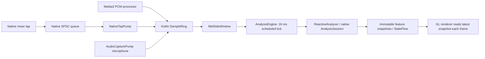

# Buffer, signal and class architecture review

This is a source review, not a device latency benchmark. The architecture is not
optimal yet. UI extraction and ownership fixes are implemented in this change;
the real-time issues below remain open and should be addressed before tuning FFT
sizes or claiming flawless synchronization.

## Signal path and timing

The playback backends are alternatives, not simultaneous producers by design.
Correct source handoff still needs enforcement. Native queue capacity is 65,536
floats: 32,768 stereo frames, approximately 683 ms at 48 kHz. That is storage
capacity, **not measured normal latency**. A 2,048-frame FFT spans about 42.7 ms
at 48 kHz or 46.4 ms at 44.1 kHz; this is signal support, not automatically an
additional scheduling delay. Current polling uses 16 ms (62.5 Hz), independent
of actual PCM advancement. End-to-end timing also includes pump scheduling,
render scheduling and display presentation.

## Prioritized open correctness findings

| Priority | Finding and source | Consequence | Required direction |
| --- | --- | --- | --- |
| High | `AnalysisEngine.stop()` cancels and discards its job; `close()` immediately frees the native analyzer. `closeAndJoin()` only joins the current job. | In-flight JNI can overlap destruction; rapid stop/start can overlap passes. | One analyzer owner, serialized work and teardown; retain and join every retiring job. Never block the audio callback waiting for FFT work. |
| High | `ReactiveAnalyzer` configuration setters call JNI directly while worker analysis can run; `AnalysisSession` mutates shared state. | Sample-rate/tuning changes race native analysis. | Apply configuration/reset/dispose on the analyzer owner, with tested ordering. |
| High | `SampleRing.beginEpoch()` resets the count independently of an in-flight writer. `snapshotLatest()` has no overwrite/generation recheck; source channels publish separately. | Old counters can reappear after reset, and a snapshot can contain mixed payload/format/generation. | Coherent epoch, sample range and channel metadata; bounded snapshot validation; explicit source handoff before reset/restart. |
| High | `Mixer.cpp` ignores partial tap writes. `NativeTapPump` flushes on sample-rate changes but seek has no tap-generation boundary. | Overflow preserves stale PCM and drops new PCM silently; seek can carry old audio/features into the new position. | Track dropped frames and discontinuities, enforce freshness on the consumer, and propagate seek/source generations. Do not have an SPSC producer mutate the consumer's cursor. |
| Medium | `AnalysisEngine.Pass.tick()` analyzes the latest window with a fixed 16 ms duration even when no new frames arrived. | Duplicate analysis on a stalled producer and inaccurate analysis time under scheduling skips. | Consume sample-indexed hops, skip duplicate ranges and reset on discontinuities; derive time from accepted samples. |

Relevant paths: `engine/audio-core/src/main/kotlin/dev/geode/engine/audio/`
(SampleRing, MidSideWindow, ReactiveAnalyzer),
`engine/scenes/src/main/kotlin/dev/geode/analysis/AnalysisEngine.kt`,
`app-runtime/src/main/java/dev/geode/playback/` (NativeTapPump, NativePlayer,
PlaybackEngine), `app-runtime/src/main/java/dev/geode/ui/CaptureController.kt`,
`core/audio/player/Mixer.cpp`, and `core/analysis/AnalysisSession.cpp`.

The native SPSC ring's acquire/release publication is sound **under its single
producer/single consumer contract**. Replacing it simply because it is lock-free
would not address the lifecycle and freshness problems around it.

`BeatGrid.cpp` requires an observed onset before emitting a beat. It does not
invent beat events during silent gaps, but its continuously advanced phase is
inferred. Observed events and inferred phase must remain distinguishable to honor
the product's no-predicted-beats requirement. The UI refactor does not implement
or certify that product migration.

## Hierarchies and module choices

Android Service/WallpaperService, Media3 SimpleBasePlayer/BaseAudioProcessor,
ViewModel and Glance inheritance implement real framework contracts. Keep them.
AudioCapturePump's shared record/worker lifecycle with microphone/capture hooks
also has meaningful shared behavior. No benefit was established for replacing
these with another inheritance hierarchy.

Feature controllers composed by PlayerSession are preferable to a giant base
class. However, PlayerSession still constructs and coordinates many collaborators
and exposes broad host contracts. Its next refactor should move feature behavior
and state together into owners; adding forwarding interfaces alone would repeat
the shallow PlaybackRepository/VisualizerRepository adapters removed here.

Media3 remains useful for session integration, decoding and video export; Hilt
owns lifecycle composition; StateFlow carries observable state. None guarantees
real-time PCM delivery. Keep high-frequency feature publication independent of
Compose recomposition, as the new frame-time provider does. Published arrays must
remain immutable, and the GL callback must not perform IO or call a main-thread
Player. Theme model Color and the shared session remain known coupling.

## Acceptance evidence needed for the next real-time change

Test stop/start/close and configuration ordering under in-flight analysis;
concurrent wrap/reset snapshots; mono/stereo/source switches; seek and overflow;
producer stalls; and cancellation while exporting. Measure sample-index-to-FFT,
FFT-to-render submission and audible-to-visible synchronization on real devices
under thermal/render load. Report distributions and drop/discontinuity counts,
not only average FPS or queue capacities.

Preserve the agreed timing policy: playback can inspect at most 100 ms of actual
upcoming PCM without adding presentation delay; microphone analysis is immediate
and causal. No whole-track preanalysis, cached musical scripts or predicted beat
schedules. This review does not claim that policy is already implemented.
