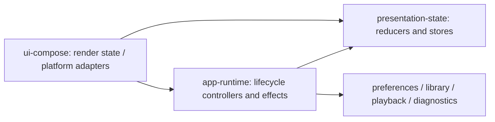

# Presentation state and effects

The presentation contract is `state + action -> next state + effects`. Compose
renders immutable snapshots and sends actions. It does not decide the next
onboarding stage, mutate navigation flags, filter the music library, sequence a
tour, perform crash-file IO or own the playback-notice timeout.

## Module direction

`presentation-state` is a JVM library with no Android or Compose dependencies.
It uses Kotlin coroutines for serialized effects and cancellable search. Public
state is read-only StateFlow. No generic reducer framework or new UI dependency
is needed. The application retains its existing Hilt/ViewModel lifetimes.

## Shell state machine

`ShellReducer` owns navigation, one mutually exclusive overlay (search, expanded
player or export), onboarding and tutorial navigation. Entry stages are Loading,
Boot, Safety, Setup, Tutorial and Ready. Preference loading must finish before
onboarding decisions; the initial default preferences cannot briefly open a
first-run dialog for an existing user. User actions are accepted only in their
valid stage. Back closes the active overlay before returning to Player.

The tour has stable step identities, bounded previous/next transitions, and skips
the hidden Studio step. Its navigation is a reducer transition, not a
LaunchedEffect in a view. Changing the future-tour preference does not dismiss
the current tour. Completion/skip emits one persistence effect; repeated
completion events do not repeat the write. Animation state and Android Display,
GL view, clipboard and activity-result adapters remain in presentation.

`ShellStore` serializes actions and awaits each persistence effect before
publishing its transition. A failed effect retains the prior state and exposes
an error; the user can dismiss the error and repeat the action. Cancellation is
propagated, not presented as a failure. Queued preference notifications resolve
the current repository snapshot when consumed, avoiding replay of a notification
that became obsolete while a write suspended. The scope owns the worker and
closes the mailbox when it ends. GUI preference writes are serialized. Shell effects use a partial-update
function under that lock, commit on IO, and publish only after the commit succeeds,
preserving unrelated settings from the prior writer. Existing continuous settings
controls retain asynchronous apply semantics; their setters do not promise durable
storage completion for every slider movement.
Tests model SharedPreferences changing its own memory even when disk commit fails;
that failed value must not appear in the repository's observable state.

`ShellViewModel` executes effects and saves a versioned primitive snapshot in
SavedStateHandle. Stable enum names avoid ordinal migrations. Restore validates
unknown names, malformed booleans and incompatible versions and waits for current
preferences. It never restores a coroutine or replays a persistence effect.
An export overlay is not restored after process death: reopening export uses its
existing feature state rather than automatically starting a render or picker.
This snapshot is navigation state, not durable export recovery.

## Search state machine

`SearchReducer` has Idle, Loading, Ready and Failed states. Every request or source
refresh has a monotonically increasing revision and clears prior selectable
results immediately. Completion/failure is accepted only for the current loading
revision. `LatestSearch` debounces 250 ms and cancels superseded jobs; revision
validation also protects against late, non-cooperative results.

`SearchViewModel` combines source changes, snapshots the current library and
presets, filters/deduplicates on Dispatchers.Default, and validates selected rows
against current results before issuing playback/queue/preset commands. Query text
survives process recreation; derived results and in-flight work are recomputed.
Screens render loading/error/results and dispatch user intent. Clearing a query
returns Idle and cancels pending work. Exceptions become Failed; coroutine
cancellation does not.

## Scope and feature migration rule

This change migrates the app shell, entry flow, tutorial, global search and
associated diagnostic/notice effects. Existing library, player, visual and studio
screens still consume their feature ViewModels; their forms and platform-picker
workflows have not all been rewritten as reducers. ExportHost, for example,
still owns its existing picker-specific pending requests. This is not a claim
that every composable in the application is now free of workflow logic.

For subsequent feature changes, put workflow state/actions/reducers beside the
feature's controller, keep IO and jobs in the controller, and expose state and
intent callbacks to views. Keep transient drawing details (focus, drag position,
animation progress) local. Use sealed states where mutually exclusive workflow
stages would otherwise be represented by overlapping booleans. Do not wrap every
property assignment in a framework or expose mutable flows to views.

## Regression coverage

Tests exercise entry-gate ordering, invalid/duplicate actions, overlay replacement
and Back priority, tutorial preference changes and bounds, corrupted/restored
snapshots, serialized and failed effects, cancellation, stale preference
notifications, debounce, search refresh and late result rejection. A bounded
exploration of action sequences checks shell invariants after every transition.
Run `./gradlew :presentation-state:test` independently of the Android toolchain.
CI includes this JVM module in addition to existing Android/JVM test tasks.
Device checks still needed: activity recreation/process death, physical Back and
predictive Back, keyboard/search, and platform export-picker return behavior.
