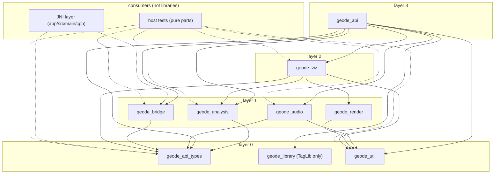

# Native libraries

The C++ under `core/` is split into static libraries, one per directory (ADR-0005, "Native code"). The app's JNI library `libgeode.so` links them all through the `geode_core` interface target, so its link line is what the single `geode_core` static library used to give it.

## Layout

```
core/<lib>/
  include/geode/<lib>/   public headers: the library's contract, included as "geode/<lib>/Header.hpp"
  ...                    sources and private headers, included relative to core/<lib>/
```

Each library exports only `core/<lib>/include` (`target_include_directories(... PUBLIC ...)`); its own directory is a private include path. A header becomes public only when another library, the host tests or the JNI layer needs it, together with whatever public headers it includes in turn.

## Libraries and dependencies

| Target | Directory | What it holds | Depends on (public / private) |
|---|---|---|---|
| `geode_api_types` (interface) | `core/api/include` | `geode/api/geode_api.h`: the C ABI's types and functions | — |
| `geode_util` | `core/util` | JSON, SHA-256, logging, shader assembly (includes and `#line` directives) | — |
| `geode_bridge` | `core/bridge` | What crosses between Kotlin and the engine: the Customization snapshot and its codec (generated from `core/bridge/schema/native_bridge.json`), the lock-free triple-buffer hand-off to the drawing and audio threads, and the guard that turns any C++ exception into a `GeodeStatus` | `api_types` / — |
| `geode_render` | `core/render` | GL plumbing: capability probing, GL profile, programs and the program binary cache, textures and the platform image decoder they are made from (`ImageDecoder`, jnigraphics), framebuffers, the fullscreen quad, compute, shader sources | — / `util` |
| `geode_analysis` | `core/analysis` | FFT, bands, onsets, tempo, beats, key, structure, the feature frame; hi-res input is decimated to 48 kHz or less first (`Decimator`) | `api_types` / — |
| `geode_audio` | `core/audio` | `dsp/` (equalizer, crossfeed, limiter, and `geode_dsp_*`, the DSP part of the C ABI, which the mixer itself calls), `player/` (decode, resample, mixer with its analysis tap, Oboe output with its self-tuning buffer and its reopen retry) | `api_types` / `util` |
| `geode_library` | `core/library` | TagLib tag reading and writing | — |
| `geode_viz` | `core/viz` | The Visual: renderer, frame graph, parameter model, Reactions, Modulators, Macro links and Automations (`ReactionGraph`, `PlanCodec`), the Normaliser into each Style family's ranges (`Normaliser`), the Shared core effects, the No-flash limiter, scenes | `api_types`, `render` / `analysis`, `util` |
| `geode_api` | `core/api` | The rest of the C ABI implementation (analysis, Visual, tags, player, Customization snapshots) | `api_types` / `analysis`, `audio`, `bridge`, `library`, `viz`, `util` |
| `geode_core` (interface) | — | What `libgeode.so` links: all of the above | everything |

Layered from the bottom up; each library depends only on layers below it. The diagram is generated from `LIBRARY_DEPS` in `tools/ci/check_native_includes.py` by `tools/ci/native_graph_doc.py`, and CI fails while it is stale, so it always shows the graph the include check enforces (solid arrows: a library's dependencies; dotted: what the two consumers may include):

<!-- native-graph:begin -->
<!-- Generated by tools/ci/native_graph_doc.py from LIBRARY_DEPS in tools/ci/check_native_includes.py. Edit the table, run the script, commit both. CI fails while this block is stale. -->

<!-- native-graph:end -->

No library includes or links anything in its own layer or above. The include check cannot see a call made without an include, so a symbol-level cycle would have to be caught in review; the one there was (the mixer calling `geode_dsp_process`, defined under `core/api`) was removed by moving `geode_dsp_api.cpp` into `audio`. The C ABI header is its own interface target because every library speaks its types while `geode_api`, which implements it, depends on every library; folding the two together would make a cycle.

The Visual (`viz`) and the App UI stay apart: nothing native knows about the App UI. The JNI layer sees only `geode/api/geode_api.h` and the bridge's guard (`geode/bridge/Guard.hpp`), which every JNI entry point runs its body through.

## The bridge

ADR-0005's "Native code" decisions live in `geode_bridge` and the JNI layer:

- **One schema.** `core/bridge/schema/native_bridge.json` defines the Customization snapshot's wire format and the bridge's status codes. `tools/bridge_schema/generate.py` writes `geode/api/geode_status.h`, `geode/bridge/CustomizationSnapshot.hpp` with its codec, and the Kotlin `NativeStatus` and `CustomizationSnapshot` in `:engine:audio-core`. The snapshot's array sizes are read from the engine's own constants (`SceneParams::kFieldCount`, `GEODE_LFO_SLOTS` × `GEODE_LFO_CONFIG_FLOATS`, `GEODE_ADSR_SLOTS` × `GEODE_ADSR_CONFIG_FLOATS`), so a change to one of them makes the generated files stale. CI fails when they are stale, and a test on each side checks the same fixture's bytes.
- **Hand-off without locks.** `SnapshotExchange` gives each reader (the drawing thread at the start of `geode_viz_render`, the analysis at the start of `geode_analysis_pull`) its own `TripleBuffer`. Kotlin's `SnapshotPublisher` publishes a snapshot only when it changed; a second publisher arriving mid-publish is told `GEODE_STATUS_BUSY` instead of waiting.
- **No exceptions across the bridge.** Every JNI entry point runs through `jni_guard.hpp`: a call with nothing else to return gives Kotlin its `GeodeStatus`, a call that returns a value gives a safe fallback when the engine threw. Each caught throw is reported to Kotlin's `NativeFailures`, which maps it to a named `EngineFailure` for the app-wide banner, and the native player reopens the current track where it was (`AudioRestartPolicy`, at most three times a minute). The guard catches C++ exceptions; a crash by signal (a segfault) still ends the process.

## What keeps it this way

- **CMake.** `core/native_libraries.cmake` defines `geode_core_library()`, which gives each library its public and private include directories. `core/CMakeLists.txt` (device) and `core/host/CMakeLists.txt` (host tests) both use it, so the boundaries are the same in both builds.
- **CI.** `tools/ci/check_native_includes.py` runs first in the C++ job, followed by `tools/ci/native_graph_doc.py --check`, which fails when the diagram above no longer matches `LIBRARY_DEPS`. It resolves every `#include` in `core/` and `app/src/main/cpp/` the way the compiler would and fails when a file reaches another library's private header (by any path, `../` included) or a public header of a library it does not depend on. Its `LIBRARY_DEPS` table mirrors the `target_link_libraries` lines and is checked for cycles.
- **Host tests.** The bridge's hand-off has concurrent stress tests, run under AddressSanitizer with the rest of the suite and under ThreadSanitizer in a job of their own. `core/pure_sources.cmake` keeps one list of host-testable sources per library; the host build compiles each list as that library's target and the tests link them through `geode_core_pure`.

## Known gaps

- **Public surfaces are wider than one header.** A library's public headers are the closure of what other libraries include: `AnalysisSession.hpp` holds its analysers by value, so their headers are public too; the same holds for `Renderer.hpp` in `viz`, `Player.hpp` and `DspChain.hpp` in `audio`, and the GL wrappers `viz` uses from `render`. Narrowing each library to one small header (for example by moving those members behind a pointer to an implementation) is a follow-up; the boundary check already holds whatever the surface is.
- **`render` has no host tests.** All of it needs GLES; `tools/hostlink` compiles and links it on the host with Mesa.
